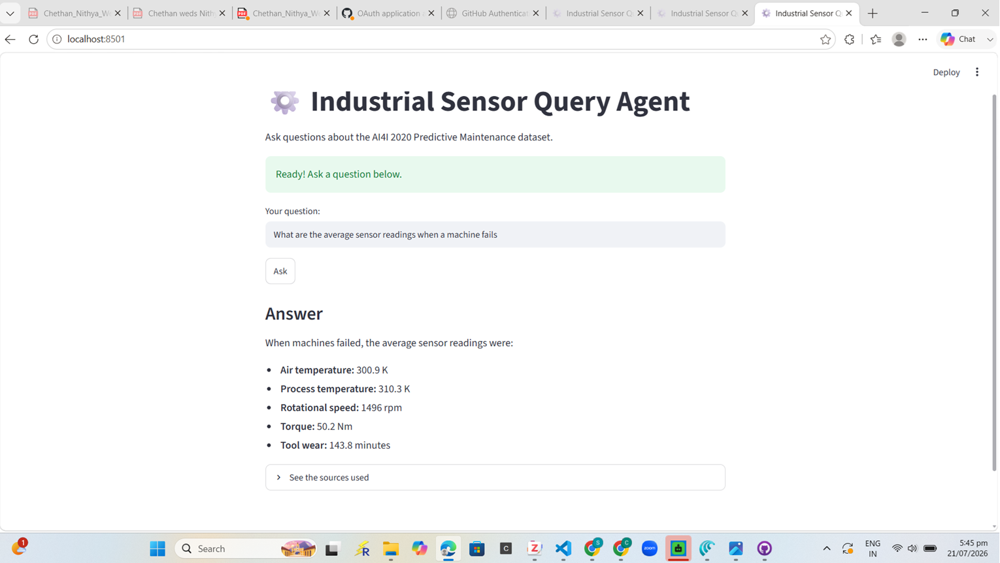

# ⚙️ Industrial Sensor Query Agent

A Retrieval-Augmented Generation (RAG) system that answers natural-language questions about industrial machine sensor data with grounded, source-cited responses. Built on the AI4I 2020 Predictive Maintenance dataset.

## What it does

Ask plain-English questions about predictive maintenance data — failure modes, sensor readings, failure statistics — and get accurate answers grounded in the dataset, with the source documents shown for transparency.

Example questions:
- "What causes heat dissipation failure?"
- "What are the average sensor readings when a machine fails?"
- "How many power failures occurred?"

## Tech Stack

- **LLM:** Mistral (`mistral-small-latest`) via LangChain
- **Embeddings:** Mistral (`mistral-embed`)
- **Vector store:** FAISS
- **Framework:** LangChain
- **Interface:** Streamlit
- **Dataset:** AI4I 2020 Predictive Maintenance Dataset (UCI ML Repository, 10,000 records)

## How it works

1. **Knowledge base construction** — the numeric AI4I dataset is transformed into text documents: a data dictionary, failure-mode descriptions, and statistics computed directly from the raw data.
2. **Chunking** — documents are split into overlapping chunks for precise retrieval.
3. **Embedding & indexing** — each chunk is embedded with Mistral and stored in a FAISS vector index.
4. **Retrieval** — for each question, the most semantically relevant chunks are retrieved.
5. **Grounded generation** — retrieved context is passed to Mistral with instructions to answer only from that context, preventing hallucination.
6. **Interface** — a Streamlit web app provides real-time Q&A and shows the source chunks used for each answer.

## Design note

The AI4I dataset is structured/tabular, so raw numeric rows are not embedded directly. Instead, the data is converted into descriptive text (definitions, failure-mode logic, and computed statistics), which is the appropriate use of semantic retrieval. This keeps answers accurate and retrieval meaningful.

## Setup

    git clone https://github.com/chandanarashwathappa/sensor-agent.git
    cd sensor-agent

    python -m venv venv
    .\venv\Scripts\Activate.ps1

    pip install -r requirements.txt

    # Add your Mistral API key to a .env file:
    # MISTRAL_API_KEY=your-key-here

    python explore.py
    python build_knowledge_base.py
    streamlit run app.py

## Project structure

    sensor-agent/
    ├── app.py                    # Streamlit web interface
    ├── rag.py                    # RAG pipeline
    ├── explore.py                # Downloads and inspects the dataset
    ├── build_knowledge_base.py   # Generates the text knowledge base
    ├── knowledge_base/           # Generated text documents
    ├── data/                     # Dataset CSV
    └── requirements.txt

## Author

**Chandana Rajaputhrapalya Ashwathappa**
M.Sc. Electrical Engineering & IT — Otto von Guericke University, Magdeburg