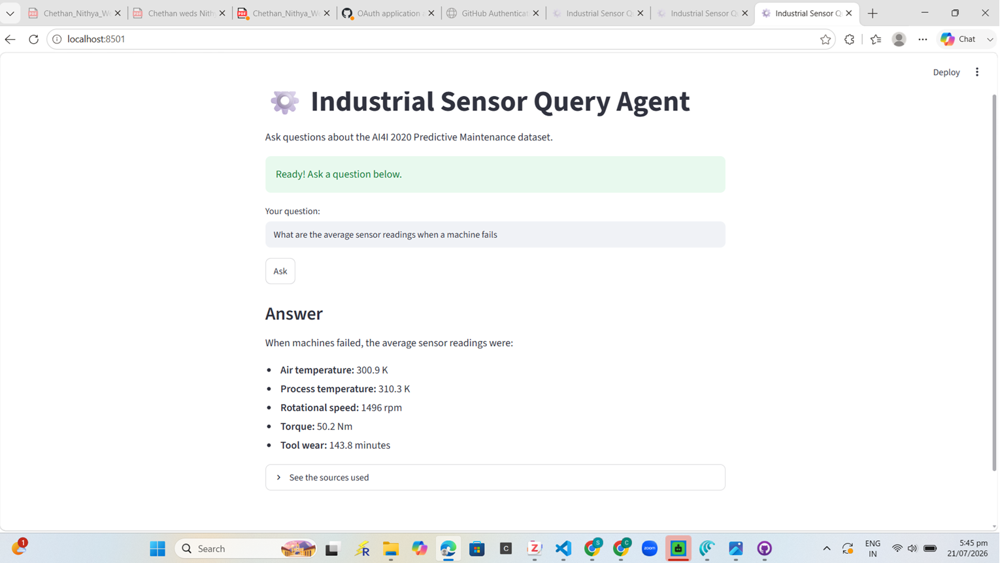

# ⚙️ Industrial Sensor Query Agent

[](https://github.com/chandanarashwathappa/sensor-agent/actions/workflows/ci.yml)

Ask plain-English questions about machine sensor data and get answers you can check.
Built on the **AI4I 2020 Predictive Maintenance** dataset (10,000 milling-machine records,
339 failures) with **Mistral**, **LangChain tool calling**, **FAISS** and **Streamlit**.

The point of the design: **the language model never computes numbers itself.** It
chooses a tool. Numeric questions go to predefined, tested pandas functions, explanations
come from retrieved documentation, and the app shows every tool call and its result.



## How it works

```
                       ┌────────────────────────────────────────────┐
  question ──────────► │ Mistral (mistral-small-latest, temp 0)     │
                       │ decides which tool(s) to call              │
                       └──────┬───────────────────────────┬─────────┘
                              │ numbers                   │ explanations
                ┌─────────────▼─────────────┐   ┌─────────▼──────────────┐
                │ analytics tools (pandas)  │   │ search_documents (RAG) │
                │ count_machines            │   │ mistral-embed + FAISS  │
                │ failure_rate              │   │ data dictionary,       │
                │ sensor_statistic          │   │ failure-mode rules,    │
                │ count_threshold           │   │ usage notes            │
                │ compare_failed_vs_normal  │   └─────────┬──────────────┘
                │ dataset_overview          │             │
                └─────────────┬─────────────┘             │
                              └──── results ─────► answer + "how this was answered"
```

- **Analytics tools, not generated code.** LangChain's pandas agent lets the model write and
  execute Python, which is unsafe and hard to test. Here the model can only call six
  functions with validated arguments (sensor names, product types and failure modes are
  enums). Invalid arguments are returned to the model as an error.
- **RAG for knowledge:** definitions, units and the physical rules behind each failure mode,
  split by paragraph, embedded with `mistral-embed` and searched with a FAISS
  inner-product index (cosine similarity).
- **Transparency:** the UI lists every tool call with its arguments and raw result.
- **Grounding:** the system prompt forbids estimated numbers and requires "the dataset does
  not contain that information" for questions the tools can't answer.

## Example questions

| Question | Route |
|---|---|
| How many machines failed? | `count_machines(failed=True)` → 339 |
| Average torque of failed vs normal machines? | `compare_failed_vs_normal(sensor="torque")` |
| How many machines with tool wear above 200 min failed? | `count_threshold(tool_wear > 200)` |
| Which product type has the highest failure rate? | `failure_rate()` |
| What causes a heat dissipation failure? | `search_documents("heat dissipation")` |
| What was the failure rate in 2019? | no tool can answer → says so |

## Evaluation

`evaluation/` contains **20 questions with ground truth computed directly from the CSV**
with separate pandas code (16 numeric, 4 text, including one question the dataset
can't answer). Grading is deterministic, not done by an LLM: numeric answers must contain the
expected value within a stated tolerance, text answers must contain required keywords.

```sh
python -m evaluation.run_eval      # needs MISTRAL_API_KEY; writes evaluation/results.md
```

**Result:** _run the evaluation and enter the score here, for example "18/20 correct";
the details are in [evaluation/results.md](evaluation/results.md)._

## Tests (offline, in CI)

22 pytest tests run without an API key:
- analytics functions against independent pandas calculations, argument validation
- knowledge base content and FAISS retrieval (deterministic fake embeddings)
- the agent loop with a scripted fake LLM: tool results are sent back, invalid arguments
  and unknown tools are handled, the step limit forces a final answer, and the tool schemas
  are valid for function calling
- the grading logic of the evaluation

## Setup

```sh
git clone https://github.com/chandanarashwathappa/sensor-agent.git
cd sensor-agent
python -m venv venv
venv\Scripts\activate            # Windows  (Linux/macOS: source venv/bin/activate)
pip install -r requirements.txt
copy .env.example .env           # then put your Mistral API key into .env
streamlit run app.py
```

```sh
pytest -v                        # offline tests, no key needed
```

## Project structure

```
agent/analytics.py     safe pandas tools (counts, rates, statistics, thresholds)
agent/knowledge.py     documentation text, paragraph chunking, FAISS index
agent/agent.py         tool-calling loop, tool schemas, system prompt
app.py                 Streamlit UI
evaluation/            20-question set, deterministic grader, runner
tests/                 offline pytest suite
scripts/download_data.py   re-download the dataset from UCI (optional)
data/ai4i2020.csv      dataset (UCI, CC BY 4.0)
```

## Limitations

- AI4I 2020 is **synthetic** and small; real plant data is messier and changes over time.
- The tools cover common questions (filters by failure, product type and failure mode,
  one sensor at a time). Questions outside them, like correlations or time trends, are
  answered as "not available" instead of being guessed.
- The answer text is still written by the LLM, which can phrase numbers imperfectly.
  The evaluation measures this.
- Answers depend on the Mistral API (network and API key required).

## How this project was built

Version 1 (RAG over generated documents) was built by me. Version 2 (tool calling, the
analytics tools, evaluation and tests) was developed with AI assistance (Claude). I defined
the requirements, reviewed the design and ran the evaluation.

## Author

**Chandana Rajaputhrapalya Ashwathappa**
M.Sc. Electrical Engineering & IT, Otto von Guericke University Magdeburg

Dataset: S. Matzka, "Explainable Artificial Intelligence for Predictive Maintenance
Applications", 2020, UCI Machine Learning Repository, CC BY 4.0.
